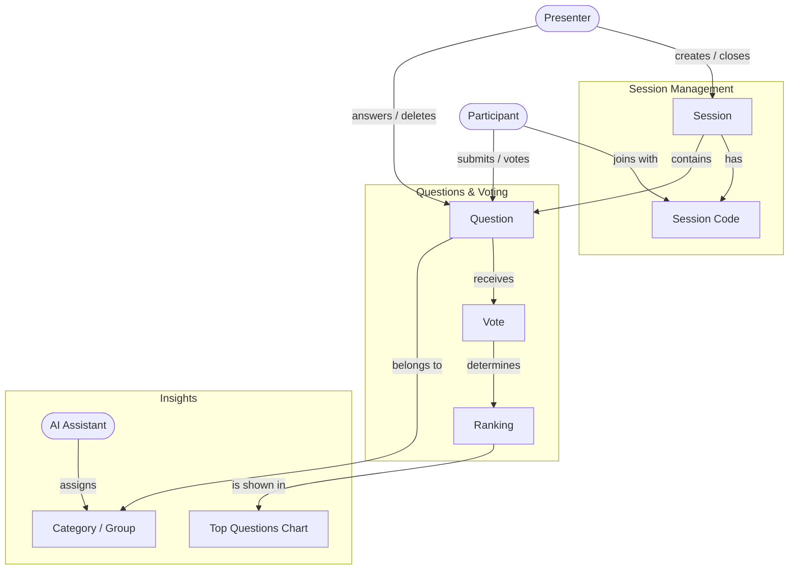

# Concept Map – Q&A Voting App

The concept map shows the central concepts of our domain (live questions during a lecture or event) and how they relate to each other.

## Ubiquitous Language (shared vocabulary)

| Term | Meaning |
|---|---|
| **Presenter** | The person giving the lecture or talk; creates and manages a session |
| **Participant** | A member of the audience; joins a session, asks and votes |
| **Session** | One live Q&A event (e.g. one lecture) |
| **Session Code** | Short code (e.g. `AB12`) participants use to join a session |
| **Question** | A text submitted by a participant in a session |
| **Vote** | An upvote given by a participant to a question |
| **Ranking** | The order of questions by number of votes |
| **Answered** | State of a question the presenter has already answered |
| **Category / Group** | Topic or cluster of similar questions (assigned by the AI) |

## Bounded Contexts

| Context | Concepts | Responsibility | Code |
|---|---|---|---|
| **Session Management** | Presenter, Participant, Session, Session Code | Create, join and close sessions | `routes/sessions.js` |
| **Questions & Voting** | Question, Vote, Ranking | Submit questions, vote, sort by votes, mark as answered | `routes/questions.js`, `routes/votes.js` |
| **Insights** | Chart, Category / Group, AI Assistant | Visualize and organize questions | later sprints |

The AI is an external dependency: it is accessed only from the *Insights* context, behind a small adapter (anti-corruption layer), so its concepts do not leak into the core model.
