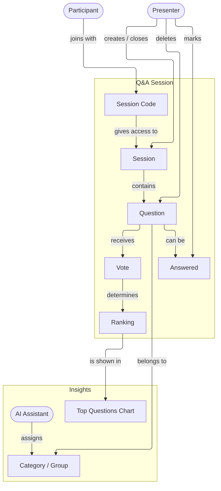
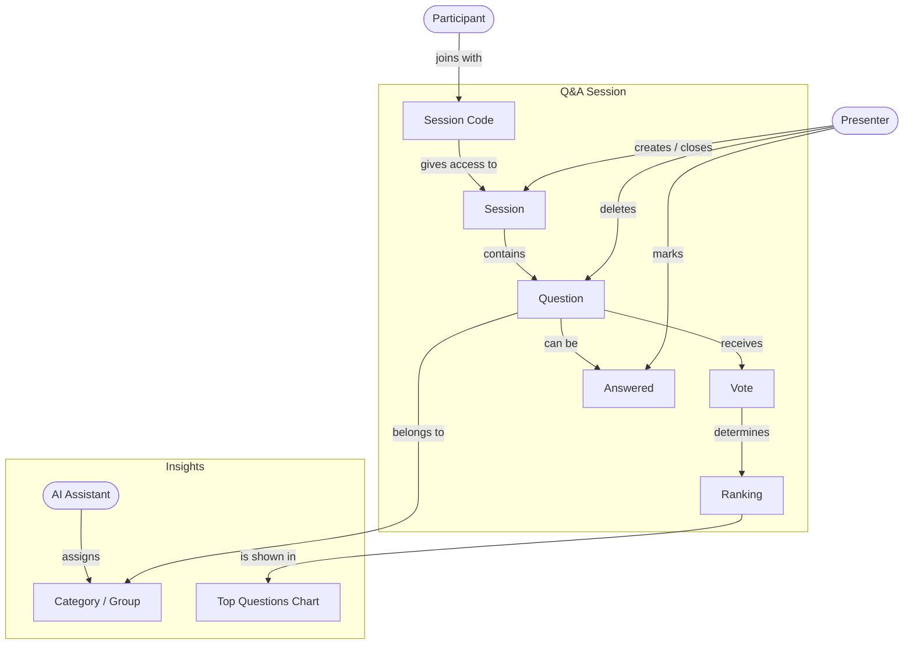

# Concept Map – Q&A Voting App

The concept map shows the central concepts of our domain (live questions during a lecture or event), how they relate to each other, and the bounded contexts they belong to.

Also available as [PDF](concept-map.pdf). Mermaid source:

## Ubiquitous Language (shared vocabulary)

| Term | Meaning |
|---|---|
| **Presenter** | The person giving the lecture or talk; creates and manages a session |
| **Participant** | A member of the audience; joins a session with the session code |
| **Session** | One live Q&A event (e.g. one lecture) |
| **Session Code** | Short code (e.g. `AB12`) that gives access to a session |
| **Question** | A text submitted by a participant in a session |
| **Vote** | An upvote given by a participant to a question |
| **Ranking** | The order of questions by number of votes |
| **Answered** | State of a question the presenter has already answered |
| **Category / Group** | Topic or cluster of similar questions (assigned by the AI) |

## Bounded Contexts

| Context | Concepts | Responsibility | Code |
|---|---|---|---|
| **Q&A Session** | Session, Session Code, Question, Vote, Ranking, Answered | Create and join sessions, submit and vote questions, sort by votes, mark as answered | `routes/sessions.js`, `routes/questions.js`, `routes/votes.js` |
| **Insights** | Top Questions Chart, AI Assistant, Category / Group | Visualize and organize the questions of a session | later sprints |

## Changes after feedback (Checkpoint 1)

- *Session Management* and *Questions & Voting* were merged into one context, **Q&A Session**: session management alone was too small to be a bounded context.
- In the session context the **Participant** only accesses the session (*joins with* the session code).
- **Answered** was added as an explicit state of a question.

The AI is an external dependency: it is accessed only from the *Insights* context, behind a small adapter (anti-corruption layer), so its concepts do not leak into the core model.
